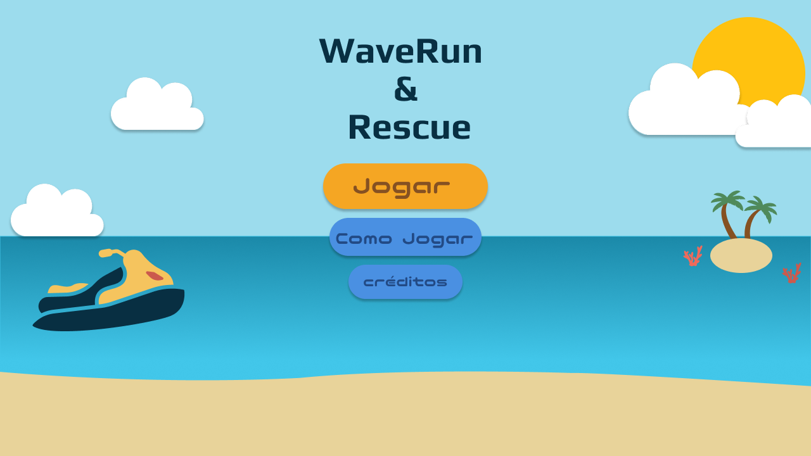

# WaveRun & Rescue

<p align="center">
  
</p>

Jogo de resgate marítimo feito com **HTML5, CSS3, JavaScript (ES6 modules) e Canvas**, desenvolvido para a avaliação NI1 da disciplina de Programação Orientada a Objetos.

## Integrantes

| Integrante |
|---|
| Anna Paula Alves Silva |
| Dilly Martins da Silva |
| Laura Rayssa Souza Araújo |
| Rafaela Carvalho Barcos Mello |

## Sobre o jogo

Você começa com um **jet ski** e precisa resgatar pessoas que estão na água, desviando de pedras e boias. Quando a embarcação lota, ela **evolui** para uma maior (lancha e depois navio), leva os passageiros junto e o mar muda de aspecto.

A partida termina com a **vitória** ao lotar o navio, ou com **Game Over** se você bater em um obstáculo ou se o tempo de resgate acabar.

## Como jogar

### Opção 1: pelo link 

1. Abra o endereço do jogo no GitHub Pages: **[colocar o link aqui]**.
2. Clique em **Jogar**.

Não é preciso instalar nada. Funciona no **Chrome**, no **Edge** e no **Firefox**, com a tela na horizontal.

### Opção 2: no seu computador

O jogo usa módulos do JavaScript, e por segurança o navegador **não permite** abri-los com duplo clique no `index.html`. É preciso um servidor local simples. O passo a passo abaixo usa o Python.

**1. Verifique se você já tem o Python**

Abra o terminal (no Windows, pesquise por *PowerShell*; no Mac ou Linux, abra o *Terminal*) e digite:

```bash
python --version
```

Se aparecer algo como `Python 3.12.0`, pule para o passo 3. Se der erro, siga o passo 2. No Mac e no Linux, se `python` não funcionar, tente `python3 --version`.

**2. Instale o Python (somente se não tiver)**

1. Acesse [python.org/downloads](https://www.python.org/downloads/) e baixe a versão mais recente.
2. Abra o instalador. No Windows, **marque a caixa "Add python.exe to PATH"** na primeira tela e clique em *Install Now*.
3. Feche o terminal, abra outro e repita o teste do passo 1.

**3. Baixe o projeto**

1. Baixe o projeto (no GitHub, clique em *Code* e depois em *Download ZIP*).
2. Extraia o ZIP em uma pasta do computador.

**4. Abra o terminal dentro da pasta do projeto**

A pasta certa é a que contém o arquivo `index.html`. No Windows, abra essa pasta no Explorador de Arquivos, clique na barra de endereço, digite `powershell` e aperte Enter. Outra opção é usar o terminal e entrar na pasta com o comando `cd`:

```bash
cd caminho/da/pasta/resgate-maritimo
```

**5. Inicie o servidor**

```bash
python -m http.server 8000
```

(No Mac e no Linux, use `python3` no lugar de `python`, se for o caso.) O terminal vai mostrar uma mensagem dizendo que o servidor está rodando. **Deixe essa janela aberta** enquanto joga.

**6. Abra o jogo**

No navegador, acesse o endereço:

```
http://localhost:8000
```

**7. Quando terminar**

Volte ao terminal e aperte `Ctrl + C` para encerrar o servidor.

> Alternativa: quem usa o VS Code pode instalar a extensão **Live Server**, clicar com o botão direito no `index.html` e escolher *Open with Live Server*.

## Como testar

Sugestão de roteiro para avaliar o jogo:

1. Na tela inicial, teste **Jogar**, **Como jogar** (confira o texto e o botão Voltar) e **Créditos**.
2. Durante a partida, confira:
   - as setas **↑** e **↓** trocando de raia;
   - a seta **→** acelerando e a seta **←** dando ré;
   - o resgate de pessoas, com o contador de resgates aumentando;
   - a colisão com pedra ou boia, que deve terminar o jogo;
   - a pausa (tecla **P** ou **Esc**, ou o botão ⏸), com continuar, reiniciar e menu;
   - a evolução do jet ski para lancha e da lancha para navio;
   - o mar agitado e a tempestade com o navio, conforme a ocupação.
3. Ao final, veja a tela de **Missão concluída** (km, resgates e velocidade máxima) e a tela de **Game Over**.

## Controles

| Tecla | Ação |
|---|---|
| ↑ / ↓ | Troca de raia (sobe ou desce) |
| → | Acelera |
| ← | Dá ré |
| P ou Esc | Pausa e continua |

Na tela de pausa, o botão ↻ reinicia a partida e o botão ☰ volta ao menu.

## Regras

- **Resgate:** aproxime o barco de uma pessoa na água. O resgate acontece quando há vaga a bordo. Cada pessoa só pode ser resgatada uma vez.
- **Capacidade:** o condutor conta como ocupante. Jet ski: **3**. Lancha: **14**. Navio: **40**.
- **Evolução:** ao lotar, a embarcação evolui e a próxima nasce exatamente no lugar onde a anterior estava.
- **Tempo de resgate:** cada embarcação tem um tempo máximo para fazer o próximo resgate: jet ski **1 minuto**, lancha **3 minutos**, navio **6 minutos**. O tempo **não reinicia** a cada pessoa resgatada: ele só volta a contar do zero quando a embarcação evolui.
- **Colisão:** a embarcação tem um contorno próprio, feito de círculos, que se aproxima do formato real do barco. Só há colisão quando esse contorno encosta na pedra ou na boia, e não quando as imagens apenas se sobrepõem.
- **Derrota:** bater em um obstáculo, ou deixar o tempo de resgate acabar, termina a partida com Game Over, em qualquer fase.
- **Clima do navio:** com **25** passageiros o mar fica agitado; com **30** volta a ficar calmo.
- **Vitória:** lotar o navio (40 passageiros) termina a partida com a tela de "Missão concluída".

## Fases

| Fase | Embarcação (capacidade) | Mar | Obstáculos |
|---|---|---|---|
| 1 | Jet ski (3) | Calmo | Pedras |
| 2 | Lancha (14) | Agitado | Pedras e boias |
| 3 | Navio (40) | Tempestade (chuva e escurecimento) | Pedras e boias, mais frequentes |

## Estrutura de pastas

```
resgate-maritimo/
├── index.html                   # página, HUD, pop-ups e telas
├── README.md                    # este arquivo
├── css/
│   └── style.css                # visual; medidas relativas à moldura do jogo
├── js/
│   ├── main.js                  # ponto de entrada: carrega imagens e liga tudo
│   ├── config/
│   │   └── Config.js            # constantes: fases, clima, tempos e capacidades
│   ├── core/
│   │   ├── Game.js              # estados do jogo (menu, jogando, pausa, fim) e evolução
│   │   ├── GameLoop.js          # loop de quadros (requestAnimationFrame)
│   │   └── InputManager.js      # leitura do teclado
│   ├── entities/
│   │   ├── Vehicle.js           # classe base das embarcações
│   │   ├── JetSki.js            # extends Vehicle
│   │   ├── Lancha.js            # extends Vehicle
│   │   ├── Navio.js             # extends Vehicle (movimento com inércia)
│   │   ├── Survivor.js          # pessoa na água
│   │   └── Obstacle.js          # pedra ou boia
│   ├── systems/
│   │   ├── CollisionSystem.js   # colisões e alcance do resgate
│   │   ├── RescueSystem.js      # cria pessoas e confirma resgates
│   │   ├── ObstacleSystem.js    # cria e remove obstáculos
│   │   └── ProgressionSystem.js # ordem das fases
│   ├── environment/
│   │   ├── Sea.js               # mar, ondas e areia
│   │   └── Weather.js           # chuva e escurecimento
│   └── ui/
│       ├── HUD.js               # barra superior
│       ├── PopupManager.js      # fila de pop-ups e animação de evolução
│       └── ScreenManager.js     # menu, pausa, Game Over, vitória e créditos
├── assets/
│   ├── backgrounds/             # imagens de fundo das telas
│   ├── vehicles/                # jet ski, lancha e navio (vista de cima)
│   ├── survivors/               # pessoas na água
│   └── ui/                      # ícones e imagens das telas
```

## Programação orientada a objetos

- **Classes e objetos:** `Vehicle`, `Survivor`, `Obstacle`, `Game`, `HUD` e outras. Cada embarcação em jogo é um objeto criado a partir de uma dessas classes.
- **Herança (`extends`):** `JetSki`, `Lancha` e `Navio` herdam de `Vehicle`, que guarda posição, velocidade, ocupação e os métodos comuns.
- **Polimorfismo:** a classe base chama `move()` e `draw()` sem saber qual embarcação é. Cada subclasse sobrescreve esses métodos com comportamento próprio:
  - `JetSki.draw()` desenha um espirro de água;
  - `Lancha.draw()` e `Navio.draw()` desenham uma esteira;
  - `Navio.move()` usa inércia para mudar de raia;
  - os getters `maxSpeed`, `capacity`, `rescueTimeLimit` e `bowAngle` têm valor diferente em cada classe.
- **Encapsulamento:** a ocupação é um campo privado (`#occupants`) e só muda por `addOccupant()`, que respeita a capacidade. As pessoas resgatadas guardam seu estado em um campo privado (`#rescued`).
- **Canvas:** todo o desenho é feito em um elemento `<canvas>` por meio da API 2D. A cada quadro, o jogo limpa a tela e desenha tudo de novo.

Todos os arquivos de código têm comentários em português que explicam o que cada parte faz.

